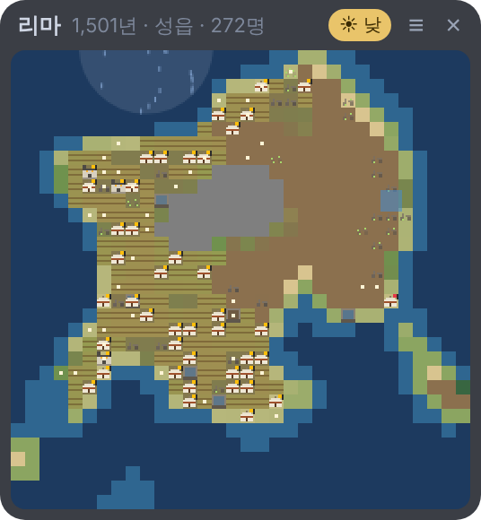

# 사이버 지구 (CyberEarth)

**바탕화면 한쪽에 띄워 두는 작은 섬. 당신이 없는 동안에도 그 섬의 역사는 흘러갑니다.**

[⬇ 최신 판 받기 (Releases)](https://github.com/bunjojang/cyber-earth-release/releases/latest)

---

## 어떤 프로그램인가요?

사이버 지구는 Windows 바탕화면에 투명한 작은 창(284×316)으로 떠 있는 **32×32칸짜리 섬**입니다.

- 섬에는 비가 오고, 풀과 숲이 자라고, 가뭄이 들면 메마릅니다.
- 어느 날 떠돌던 사람들이 바닷가에 오두막을 짓고, 마을을 이루고, 농사와 쇠 연장과 성읍을 거쳐 왕국으로, 언젠가는 현대까지 나아갑니다.
- 나라들은 싸우고, 정복하고, 반란으로 갈라지고, 흉년 한 번에 무너져 암흑기를 맞기도 합니다. 문명이 끝나면 폐허 위로 풀이 덮이고, 바다 건너 새 사람들이 찾아옵니다.

이 모든 일은 **정해진 이야기가 아니라 규칙이 만들어 내는 결과**입니다. 같은 섬이라도 매번 다른 역사가 펼쳐집니다.

## 왜 만들었나요?

**"사이버 선인장"** 같은 프로그램을 만들고 싶었습니다.
매일 들여다보며 돌봐야 하는 게임이 아니라, 책상 위 화분처럼 그냥 켜 두면 스스로 살아가는 작은 세계입니다.

- **내가 없는 동안의 이야기.** 위젯을 닫아 두어도 세계는 흘러갑니다. 다시 열면 *"당신이 없던 8시간 동안 이 세계에서 2,400년이 흘렀습니다"* 와 함께 그 사이 일어난 큰 사건을 알려 줍니다. (닫혀 있던 시간은 최대 24시간까지 몰아서 계산합니다. 현실 1분 = 세계의 5년)
- **창조주가 된다는 것.** 당신은 이 섬의 창조주입니다. 비를 내리거나 가뭄을 들게 하거나 운석을 떨어뜨릴 수 있지만, 사람들의 삶을 직접 고르지는 않습니다. 대신 사람들은 당신이 한 일을 **신의 뜻으로 해석**합니다. 비는 은혜가 되고, 가뭄은 노여움이 되어 제단을 쌓거나 왕을 끌어내립니다.
- **역사는 연표로 남습니다.** 일어난 일은 모두 `문서\CyberEarth\<세계 이름>_연표.txt` 에 메모장으로 읽을 수 있게 쌓입니다. 내 섬에서 무슨 일이 있었는지 나중에 천천히 읽어 볼 수 있습니다.

## 창조주가 할 수 있는 일

위쪽 막대의 **≡ 메뉴 → 개입**에서 고른 뒤 지도를 누릅니다. (오른쪽 클릭이나 Esc로 취소)

| 힘 | 하는 일 |
|---|---|
| 비 | 누른 곳에 은혜로운 비. 사람들은 하늘의 은혜라 여깁니다 |
| 가뭄 | 켜고 끄는 가뭄. 위젯을 닫아도 이어집니다 |
| 운석 | 땅이 파이고 하늘이 먼지로 덮여 흉년이 듭니다. 바다에 떨어지면 해일이 일어납니다 |
| 화산 | 산을 터뜨립니다. 용암이 바다를 메우고, 화산재 덮인 땅은 훗날 가장 기름진 땅이 됩니다 |
| 역병 | 누른 곳의 나라에서 시작해 이웃 나라로 번집니다 |
| 생명 | 숲을 일으킵니다. 섬에 아무도 없으면 흙으로 사람을 빚어 내려보냅니다 |
| 땅 | 바다를 솟게 해 섬을 넓힙니다. 여러 번 누를 수 있습니다 |

아무것도 하지 않아도 됩니다. 손대지 않은 섬도 스스로 자라고 무너지고 다시 일어섭니다.

## 섬에서 일어나는 일들

- **숨겨진 기술 단계:** 채집 → 농사 → 관개 → 쇠 연장 → 성읍 → 왕국 → 중세 → 근세 → 산업 → 현대. 플레이어가 고르지 않아도 넉넉히 거둔 사회에서 저절로 열리고, 무너지면 기술을 잊었다가 다시 찾기도 합니다.
- **나라마다 다른 삶:** 처음 자리 잡은 땅에 따라 농경 · 바다 · 유목 · 산악의 삶을 삽니다. 왕정 · 신정 · 공화정 · 제국 · 혁명 · 독재 · 민주정이 생겨나고 바뀝니다.
- **발명과 위인, 황금기, 동맹과 배신, 전쟁과 정복, 반란.**
- **댐과 저수지, 간척, 교역과 교역로 단절, 산업 시대의 온난화와 기후 재해.**
- **시대의 빛깔:** 암흑기에는 세상의 색이 바래고, 황금기에는 맑게 빛납니다.

## 최근 업데이트 — 0.2.0

- **창조주의 큰 힘:** 비 · 가뭄에 더해 **운석 · 화산 · 역병 · 생명 · 땅**이 생겼습니다.
- **신화:** 사람들이 창조주의 비를 은혜로, 가뭄을 노여움으로 받아들입니다. 제단을 쌓고 제물을 바치고, 가뭄이 그치지 않으면 "하늘이 왕을 버렸다"며 들고일어납니다.
- **나라마다 다른 역사:** 삶의 방식, 정치 체제, 발명, 위인, 황금기, 동맹과 배신.
- **새 세계 모양:** 설정 → 새 세계에서 **작은 섬 · 큰 섬 · 여러 섬**을 고를 수 있습니다.
- **시대의 빛깔:** 암흑기와 황금기가 색으로 보입니다.
- **고친 것:** 연도·인구가 길어지면 위쪽의 × 버튼이 창 밖으로 밀려 누를 수 없던 문제.

판마다 바뀐 점은 [Releases](https://github.com/bunjojang/cyber-earth-release/releases)에서 볼 수 있습니다.

## 설치 / 업데이트

1. [Releases](https://github.com/bunjojang/cyber-earth-release/releases/latest)에서 `CyberEarth-<버전>-setup.exe`를 받습니다.
2. 이미 쓰고 있었다면 위젯을 **× 로 닫은 뒤** 그대로 설치하세요. **키우던 세계는 그대로 이어집니다.**
3. "Windows의 PC 보호" 파란 창이 뜨면 **[추가 정보] → [실행]**을 누르세요. 서명하지 않은 개인 프로그램이라 뜨는 경고입니다.
4. 설치가 끝나면 바탕화면에 작은 섬이 떠오릅니다. 그냥 켜 두세요.

**사용 환경:** Windows 10 / 11 (64비트)

## 알아 두면 좋은 것

- 위쪽 막대를 끌면 위젯을 옮길 수 있고, 위치는 기억됩니다.
- ≡ 메뉴 → 기록 → **연표 열기**로 지금까지의 역사를 메모장으로 봅니다.
- ≡ 메뉴 → 설정에서 지도에 밤을 표시하거나, 새 세계를 시작할 수 있습니다. (새 세계를 고르는 순간 지금 세계는 끝나니 주의하세요)
- 세계는 이 PC 안에만 저장되고, 프로그램이 세계나 연표를 인터넷으로 보내지 않습니다.

재미있는 연표가 나오면 `문서\CyberEarth` 폴더의 연표 파일을 공유해 주세요!
