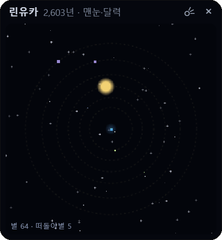

# 사이버 지구 (CyberEarth)

**바탕화면 한쪽에 띄워 두는 작은 섬. 당신이 없는 동안에도 그 섬의 역사는 흘러갑니다.**

  
  

왼쪽: 지구 창 — 섬과 사람들 · 오른쪽: 우주 창 — 그 섬 사람들이 찾아낸 하늘

<a href="https://github.com/bunjojang/cyber-earth-release/releases/latest"><b>⬇ 최신 판 받기 (Windows 10 / 11)</b></a> · <a href="CHANGELOG.md">업데이트 기록</a>

---

## 어떤 프로그램인가요?

사이버 지구는 Windows 바탕화면에 투명한 작은 창으로 떠 있는 **32×32칸짜리 섬**입니다.
섬에는 비가 오고 숲이 자라고, 언젠가 떠돌던 사람들이 바닷가에 오두막을 짓습니다. 그들은 마을을 이루고 나라를 세우고, 석기에서 현대까지 나아가다 무너지고, 다시 일어섭니다.

이 모든 일은 **정해진 이야기가 아니라 규칙이 만들어 내는 결과**입니다. 같은 섬이라도 매번 다른 역사가 펼쳐집니다.
매일 돌봐야 하는 게임이 아니라, 책상 위 화분처럼 **켜 두기만 하면 스스로 살아가는 작은 세계**("사이버 선인장")입니다.

## 주요 특징

- **내가 없는 동안의 이야기** — 위젯을 닫아 두어도 세계는 흘러갑니다. 다시 열면 *"당신이 없던 8시간 동안 2,400년"* 과 함께 떠날 때와 지금의 섬을 나란히 보여 주고, 그 사이 큰 사건을 알려 줍니다. (현실 1분 = 세계의 5년, 닫혀 있던 시간은 최대 24시간까지)
- **창조주가 된다는 것** — 비·가뭄·번개·운석·화산 같은 힘을 쓸 수 있지만, 사람들의 삶을 직접 고르지는 않습니다. 사람들은 당신이 한 일을 **신의 뜻으로 해석**해 제단을 쌓거나 왕을 끌어내립니다.
- **문명의 흥망** — 나라들은 싸우고 정복하고 갈라지며, 흉년 한 번에 암흑기를 맞기도 합니다. 현대에 이르면 핵전쟁과 내전으로 무너졌다가 벙커에서 돌아온 사람들이 다시 시작합니다.
- **살아 있는 섬** — 형질대로 이름 붙은 짐승 무리, 저절로 움직이는 땅, 온난화와 기후 재해가 사람들의 역사와 얽힙니다.
- **우주 창** — 사람들이 하늘을 올려다보며 찾아낸 별과 행성이 별도의 창에 하나둘 나타납니다. 우주정거장을 가진 문명은 끝내 별로 떠날 수 있습니다.
- **모든 별에는 끝이 있습니다** — 세계 하나는 **약 50,400년**(켜 두면 현실 약 일주일)에 꺼져 가는 해와 함께 끝납니다. 끝나는 해는 별마다 조금씩 다릅니다. 시작은 신앙이었고, 끝은 과학이 설명합니다.
- **연표** — 일어난 일은 모두 `문서\CyberEarth\<세계 이름>_연표.txt`에 쌓여 메모장으로 읽을 수 있습니다.
- **집중 타이머** — 25분 집중 / 5분 쉬기 타이머를 지도 위에 띄울 수 있습니다. 섬은 그 옆에서 조용히 흘러갑니다.

## 설치 / 업데이트

1. [Releases](https://github.com/bunjojang/cyber-earth-release/releases/latest)에서 `CyberEarth-<버전>-setup.exe`를 받아 실행합니다.
2. "Windows의 PC 보호" 파란 창이 뜨면 **[추가 정보] → [실행]**을 누르세요. 서명하지 않은 개인 프로그램이라 뜨는 경고입니다.
3. 설치가 끝나면 바탕화면에 작은 섬이 떠오릅니다. 그냥 켜 두세요.

**업데이트:** 새 판이 나오면 위젯 왼쪽 아래에 **"⬆ 새 판"** 알림이 뜹니다. 누르면 저장한 뒤 새 판으로 바뀌고, **키우던 세계는 그대로 이어집니다.** (손으로 새로 설치할 때는 위젯을 × 로 닫은 뒤 설치하세요)

**사용 환경:** Windows 10 / 11 (64비트)

## 사용법

위젯은 위쪽 막대를 끌어 옮기고, 오른쪽 아래 모서리를 끌어 키울 수 있습니다(두 번 누르면 기본 크기). 모든 기능은 위쪽 막대의 **≡ 메뉴**에 있습니다.

### 창조주가 할 수 있는 일 (≡ → 개입)

고른 뒤 지도를 누릅니다. (오른쪽 클릭이나 Esc로 취소)

| 힘 | 하는 일 |
|---|---|
| 비 | 누른 곳에 은혜로운 비. 사람들은 하늘의 은혜라 여깁니다 |
| 가뭄 | 섬 전체에 5년 동안 가뭄. 다시 누를 때마다 5년씩 길어집니다(최대 30년). 위젯을 닫아도 이어집니다 |
| 바람 | 거센 바람. 숲의 나무가 쓰러지고 오두막 지붕과 곳간 곡식이 날아갑니다. 비구름을 밀어낼 수도 있습니다 |
| 번개 | 누른 칸에 벼락. 풀밭이면 들불이 번지고(마른 땅일수록 멀리), 제단에 떨어지면 하늘이 내린 불로 여깁니다 |
| 한파 | 섬 전체에 5년 동안 매서운 추위. 흉년이 들고 바닷가가 얼어붙습니다. 지도를 누르지 않고 바로 시작되며, 다시 누르면 길어집니다 |
| 운석 | 땅이 파이고 하늘이 먼지로 덮여 흉년이 듭니다. 바다에 떨어지면 해일이 일어납니다 |
| 화산 | 산을 터뜨립니다. 용암이 바다를 메우고, 화산재 덮인 땅은 훗날 가장 기름진 땅이 됩니다 |
| 역병 | 누른 곳의 나라에서 시작해 이웃 나라로 번집니다 |
| 생명 | 숲을 일으킵니다. 섬에 아무도 없으면 흙으로 사람을 빚어 내려보냅니다 |
| 땅 | 바다를 솟게 해 섬을 넓힙니다. 여러 번 누를 수 있습니다 |

**우주 창**에서는 ☄ 버튼으로 **혜성**만 부를 수 있습니다. 땅과 사람에겐 아무 일도 일어나지 않지만, 그 시대 사람들은 저마다의 방식으로 기록합니다.

아무것도 하지 않아도 됩니다. 손대지 않은 섬도 스스로 자라고 무너지고 다시 일어섭니다.

### 메뉴

| 메뉴 | 버튼 | 하는 일 |
|---|---|---|
| 기록 | 연표 | 지금까지의 역사를 메모장으로 엽니다 |
| | 보고서 | 마지막 부재 보고서(떠날 때와 돌아왔을 때의 섬)를 다시 봅니다 |
| | 우주 | 우주 창을 열고 닫습니다. 열어 둔 채 끄면 다음에 켤 때 함께 열립니다 |
| | 타이머 | 25분 집중 / 5분 쉬기 타이머를 켜고 끕니다. 지도 위 칩을 누르면 멈추거나 다시 셉니다 |
| | 시드 | 내 섬의 시드를 복사합니다. 친구가 새 세계 → 시드에 넣으면 같은 섬에서 시작합니다 |
| 관찰 | 배속 · 강조 · 메모 · 폴더 | 관찰 모드를 켜면 나타납니다. 1× / 10× / 60× 배속, 나라 영토·시설 강조, 칸 위에 마우스를 올리면 그 칸의 정보 |
| 설정 | 밤 표시 · 관찰 모드 | 켜진 버튼은 파랗게 보입니다 |
| | 새 세계 | 작은 섬 · 큰 섬 · 여러 섬 · 친구의 시드 중에서 고릅니다. **고르는 순간 지금 세계는 끝납니다** |

> 추천: **밤 표시** 끔 + **관찰 모드** 켬 → **배속 60×**. 그리고 심심할 때마다 개입하세요!

## 섬에서 일어나는 일들

펼쳐 보기 — 시대, 나라, 짐승, 핵전쟁, 우주, 태양의 최후

- **시대:** 석기 → 철기 → 고대 → 중세 → 근대 → 현대. 위쪽 막대에 지금 섬의 시대가 보입니다. 시대 안에는 숨겨진 기술이 있어서(석기 = 채집·농사·관개, 철기 = 쇠 연장, 고대 = 성읍, 중세 = 왕국·중세, 근대 = 근세·산업), 연표에는 "관개의 시대가 열렸다", "쇠 연장의 기술이 잊혔다"처럼 기술 이름으로 남습니다. 넉넉히 거둔 사회에서 저절로 열리고, 무너지면 기술을 잊었다가 다시 찾기도 합니다. 섬이 거의 비면 **붕괴**, 해가 밝아지기 시작하면 **종말**로 바뀝니다.
- **짐승들:** 섬에는 저마다 모습이 다른 짐승 무리가 삽니다. 사람들은 사냥하고, 길들여 기르고, 맹수를 몰아내고, 짐승에게서 옮은 병을 앓습니다.
- **나라마다 다른 삶:** 처음 자리 잡은 땅에 따라 농경 · 바다 · 유목 · 산악의 삶을 삽니다. 왕정 · 신정 · 공화정 · 제국 · 혁명 · 독재 · 민주정이 생겨나고 바뀝니다.
- **발명과 위인, 황금기, 동맹과 배신, 전쟁과 정복, 반란.**
- **댐과 저수지, 간척, 교역과 교역로 단절, 산업 시대의 온난화와 기후 재해, 현대의 원자력.**
- **바다 건너 식민지와 독립, 저절로 움직이는 땅(융기·침강·산사태·협곡).**
- **시대의 빛깔:** 암흑기에는 세상의 색이 바래고, 황금기에는 맑게 빛납니다.
- **핵전쟁과 내전:** 현대에 이른 문명은 핵무기를 손에 넣습니다. 위기 속에서 나라끼리, 또는 둘로 갈라진 한 나라 안에서 핵전쟁이 벌어지면 도시가 불타고 핵겨울이 섬을 덮어, 남은 사람들은 다시 돌을 깎는 시대부터 시작합니다.
- **벙커와 잔해:** 핵전쟁이 나면 몇 사람이 땅속 벙커로 피했다가 핵겨울이 걷힌 뒤 돌아옵니다. 불탄 도시는 잿빛 잔해로 오래 남아, 다음 시대 사람들이 "옛 신들의 집"으로 섬기기도 합니다.
- **하늘을 올려다본 사람들:** 사람들은 처음부터 밤하늘을 봅니다. 달을 세고, 떠돌이별을 신이라 부르고, 별을 이어 별자리를 만들고, 망원경으로 땅이 해를 돈다는 것을 알아내고, 마침내 다른 별을 도는 행성을 찾습니다. 섬이 크게 무너지면 하늘의 앎도 잊히지만, 옛 폐허에서 별 지도를 찾아 되찾기도 합니다.
- **위성과 우주정거장:** 현대에 이른 문명은 인공위성을 띄우고 궤도 위에 사람이 머물 집을 짓습니다. 정거장을 가진 문명만이 끝내 별로 떠날 수 있습니다.
- **세 갈래의 끝:** 해가 꺼져 갈 때, 우주정거장을 가진 문명은 별로 떠나고, 떠날 수 없는 현대는 땅 밑으로 내려가고, 그 밖의 사람들은 해를 섬기며 마지막을 맞습니다. 떠난 배가 살 수 있는 행성에 닿으면 다음 세계를 그곳에서 이어 갈 수 있습니다.
- **태양의 최후:** 세계마다 조금씩 다른 때(대개 42,000~48,000년)에 중심의 연료가 바닥나 가는 해가 하얗게 타오르고, 붉게 부풀어 바다를 말리고, 작고 하얀 별로 식은 뒤 어둠이 찾아옵니다. 끝난 별의 역사는 "이 별의 역사"로 연표에 마감되고, 새 섬에서 다시 시작합니다.

## 최신 판에서 바뀐 것 — 0.6.8

- 메뉴가 열려 있을 때 알림이 지도 위쪽에 떠서 버튼을 가리지 않습니다.
- 관찰 모드의 칸 정보를 짧게 정리했습니다. 같은 종의 짐승 무리는 한 줄로 묶어 보여 줍니다.

지난 판들의 바뀐 점은 [업데이트 기록(CHANGELOG)](CHANGELOG.md)에 있습니다.

## 자주 묻는 것

**내 세계나 연표가 어딘가로 보내지나요?**
아니요. 세계는 이 PC 안에만 저장됩니다. 새 판 확인을 위해 켤 때와 6시간마다 GitHub에 접속하지만, 세계나 연표는 아무것도 보내지 않습니다. 인터넷이 없어도 섬은 그대로 돌아갑니다.

**위젯을 꺼 두면 어떻게 되나요?**
다시 켤 때 꺼져 있던 시간만큼(최대 24시간) 한꺼번에 계산하고 부재 보고서를 보여 줍니다. 해가 꺼지는 마지막 장면은 직접 볼 수 있도록, 자리를 비운 동안에는 그 직전에서 멈춥니다.

**친구와 같은 섬에서 시작할 수 있나요?**
≡ → 기록 → **시드**로 내 섬의 시드를 복사해 보내 주세요. 친구가 ≡ → 설정 → 새 세계 → **시드**에 넣으면 같은 섬에서 시작합니다. 둘 다 손대지 않으면 같은 해에 같은 역사가 펼쳐집니다.

**파란 경고 창이 떠요.**
서명하지 않은 개인 프로그램이라 Windows가 띄우는 경고입니다. [추가 정보] → [실행]을 누르면 설치됩니다.

---

재미있는 연표가 나오면 `문서\CyberEarth` 폴더의 연표 파일을 공유해 주세요!
